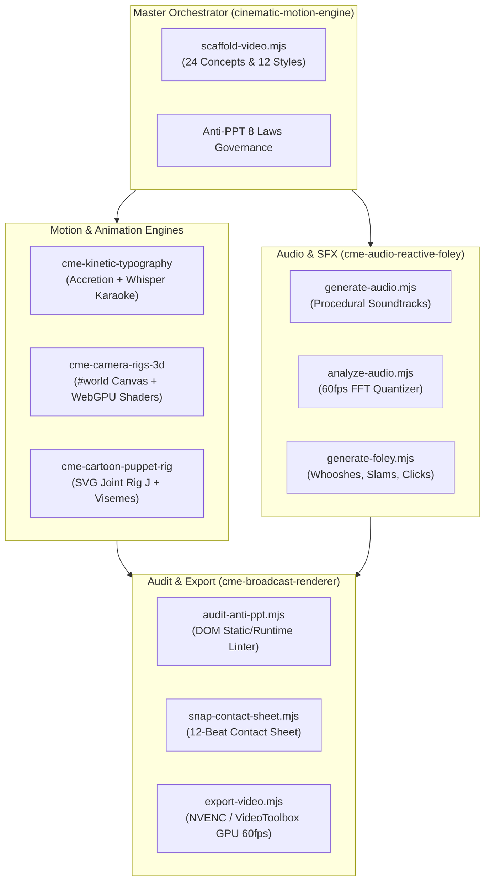

# Cinematic Motion Engine v3.0 — Architecture Blueprint & Decision Log (BLUEPRINT.md)

> **Author**: Roedy Rustam  
> **Status**: Accepted & Implemented (v3.0.0 Modular Architecture)

---

## 1. System Topology & 6-Skill Modular Flow



---

## 2. Architectural Decision Records (MADR Standard)

| # | Decision Title | Status | Context & Problem | Chosen Solution & Rationale | Consequences & Trade-offs |
| :- | :--- | :--- | :--- | :--- | :--- |
| **1** | **Modular 6-Skill Ecosystem Decomposition** | Accepted | Single monolithic skill file was bloated (~43KB), making it hard for AI agents to load specific sub-domain context (e.g., character rigging vs typography). | Decompose into 6 focused skills under `skills/` sharing a common core runtime `assets/cme-core.js`. | Reduced context token usage per sub-task; cleaner separation of concerns. |
| **2** | **Whisper AI Word-Level Sync (`sync-whisper.mjs`)** | Accepted | Audio FFT energy extraction alone could not provide word-level semantics for kinetic typography and lip-sync. | Ingest Whisper word timestamp JSON/SRT to generate millisecond-accurate word entrance arrays and viseme sequences. | Enables high-fidelity broadcast karaoke highlighting and automatic character lip-sync. |
| **3** | **Procedural Foley Generator (`generate-foley.mjs`)** | Accepted | High-end motion graphics require tactile SFX (whip-pan whooshes, text slams), but external audio libraries introduce heavy dependencies. | Pure Node.js 16-bit PCM waveform generator with mathematical synthesis (swept sines, colored noise, low-pass filters). | Zero npm dependencies; 100% deterministic audio generation running anywhere. |
| **4** | **GPU Hardware-Accelerated Video Rendering** | Accepted | CPU software encoding (`libx264`) at 60fps 1080p is slow for long timelines or high worker counts. | Implement auto-detection for `h264_nvenc` and `h264_videotoolbox` in `export-video.mjs` with software fallback. | Up to 5x faster export times on machines with dedicated GPUs. |
| **5** | **Spring Dynamics RK4 Integration in `cme-core.js`** | Accepted | Standard bezier easing occasionally feels mechanical for elastic bounces or organic secondary motion. | Implement an analytical/numerical RK4 spring solver parameterized by mass, stiffness, and damping. | Provides natural physical motion while preserving 100% frame determinism against timeline time $t$. |

---

## 3. Subagent & Module Contract Specifications (v3.0)

### `window.OPENER` Automation Contract v3.0
```ts
interface OpenerContractV3 {
  W: number;                   // Stage width (1920, 1080, etc.)
  H: number;                   // Stage height (1080, 1920, 1350, etc.)
  DURATION: number;            // Total duration in seconds
  FPS: number;                 // 60
  RATIO: '16x9' | '9x16' | '1x1' | '4x5';
  BEATS?: number[];            // Canonical beat timestamps
  WORDS?: Array<{              // Optional Whisper word timestamps
    word: string;
    start: number;
    end: number;
    phoneme?: string;
  }>;
  tl: GSAPTimeline;
  ready: boolean;
  clipsReady(): Promise<boolean>;
  seek(t: number): void;
  seekFrame(t: number): Promise<void>;
  play(): void;
}
```
