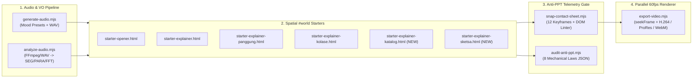

# Cinematic Motion Engine v2.1 — Architecture Blueprint & Decision Log (BLUEPRINT.md)

## 1. Understanding Summary
- **Core Goal**: Upgrade **Cinematic Motion Engine** across all 4 architectural pillars (Autonomous Audio/VO CLI, Anti-PPT DOM Telemetry Gate, Multi-Codec/Ratio 60fps Exporter, and Full 6-Mode Starter Arsenal + Plugin Sync).
- **Target Audience**: AI Coding Agents (Antigravity, Claude Code, Cursor, Codex) and motion engineers producing broadcast 60fps openers, narrative explainers, and 2D cartoon stages.

---

## 2. System Topology & Pipeline Flow



---

## 3. Architectural Decision Records (MADR Standard)

| # | Decision Title | Status | Context & Problem | Chosen Solution & Rationale | Consequences & Trade-offs |
| :- | :--- | :--- | :--- | :--- | :--- |
| **1** | **Dual-Engine Audio Analyzer (`analyze-audio.mjs`)** | Accepted | `vo-fft-analyzer.html` requires manual browser drag-and-drop, blocking autonomous CLI agents. | Build `scripts/analyze-audio.mjs` using native Node PCM parser for `.wav` + automatic `ffmpeg -f f32le` pipe for `.mp3/.m4a/.ogg`. | Zero npm audio-decoder dependencies; works on any machine with Node or FFmpeg. |
| **2** | **In-Page Anti-PPT Telemetry Injection** | Accepted | Visual screenshots alone can miss `26px` micro-text or lingering SVG blur filters. | Inject an evaluation payload inside `snap-contact-sheet.mjs` and `audit-anti-ppt.mjs` that queries `getComputedStyle` & `getBoundingClientRect` at every beat. | Catches 100% of mechanical violations automatically and prints telemetry badges on `contact-sheet.png`. |
| **3** | **Async `seekFrame(t)` + Multi-Codec Export** | Accepted | `window.OPENER.seek(t)` is synchronous and may capture before `<video>` seeks or `requestAnimationFrame` flushes. | Standardize on `await window.OPENER.seekFrame(t)` in `export-video.mjs` and add `--codec=h264|prores|webm-alpha` + `--ratio=16x9|9x16|1x1`. | Guarantees frame-accurate `<video>` plates and enables transparent alpha overlays for NLE editors. |
| **4** | **Deterministic Plugin Mirror (`sync-plugin.mjs`)** | Accepted | Maintaining duplicate files in root and `skills/cinematic-motion-engine/` causes version drift. | Create `scripts/sync-plugin.mjs` with SHA-256 verification and wire it to `npm run sync`. | Single source of truth at repository root; instant one-command synchronization. |

---

## 4. Pre-Mortem Risk Assessment & Mitigation
1. **Risk: FFmpeg not installed when running `analyze-audio.mjs` on `.wav` files.**
   - *Mitigation*: Implement a built-in pure Node.js 16-bit/32-bit RIFF WAV decoder directly inside `analyze-audio.mjs` so `.wav` files (including those from `generate-audio.mjs`) work even without FFmpeg installed; use FFmpeg automatically for compressed formats (`.mp3`, `.m4a`, `.ogg`).
2. **Risk: False-positive safe-zone warnings during mid-whip-pan frames.**
   - *Mitigation*: Only enforce strict safe-zone and `filter: none` checks when the camera is in a settled beat window (i.e. when `#mb-world-node` `stdDeviation` is `0 0`).
3. **Risk: Head expression generator drawing eyes/mouth off-center on cropped vs padded PNGs.**
   - *Mitigation*: Compute the alpha channel bounding box (`alpha > 16`) in `kepala-ekspresi.py` so facial landmarks are anchored relative to the actual visible head silhouette rather than empty transparent canvas padding.

---

## 5. Subagent & Module Contract Slice
- **`window.OPENER` Contract v2.1**:
  ```ts
  interface OpenerContract {
    W: number;               // 1920 (16:9) | 1080 (9:16 or 1:1)
    H: number;               // 1080 (16:9 or 1:1) | 1920 (9:16)
    DURATION: number;        // Total timeline duration in seconds
    FPS: number;             // 60
    RATIO: '16x9' | '9x16' | '1x1';
    BEATS?: number[];        // Optional canonical beat timestamps for snapping & audio drops
    tl: GSAPTimeline;
    ready: boolean;
    clipsReady(): Promise<boolean>;
    seek(t: number): void;
    seekFrame(t: number): Promise<void>;
    play(): void;
  }
  ```
