# 🎬 Cinematic Motion Engine

> **Modular Broadcast Programmatic Motion Graphics, Kinetic Typography, Living Cartoon Stage & 60fps Video Engine for AI Agents**  
> *(Antigravity · Claude Code · Cursor · OpenAI Codex · Windsurf · Gemini CLI)*

[](https://github.com/roedyrustam/cinematic-motion-engine/releases/tag/v3.0.0)
[](https://github.com/roedyrustam)
[](https://github.com/roedyrustam/cinematic-motion-engine)
[](https://github.com/roedyrustam/cinematic-motion-engine)

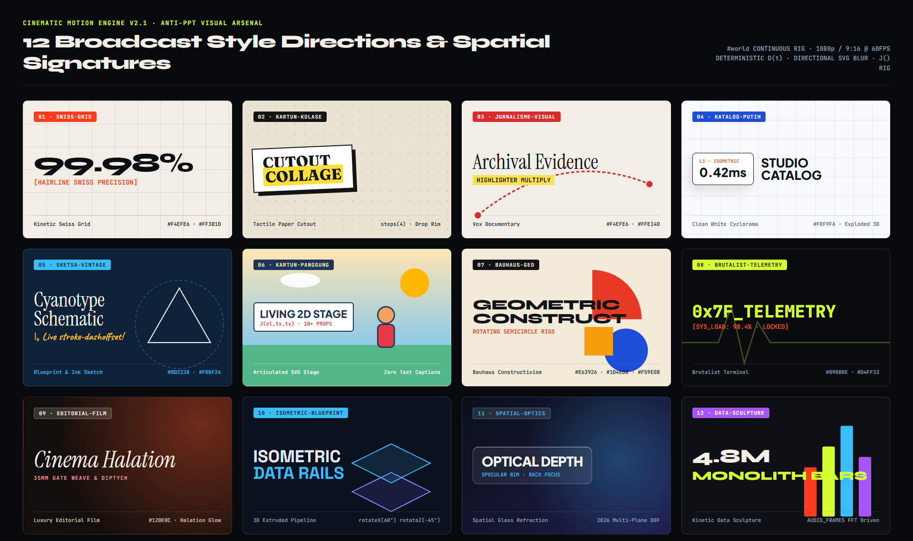

[English](#english) | [Modular Skills Suite](#-modular-skills-suite-v30) | [Style Gallery](#-visual-style-gallery--6-official-starters) | [Prompting Guide](#-ai-prompting-guide--cookbook-examples) | [Bahasa Indonesia](#bahasa-indonesia) | [Contoh Prompting (ID)](#-panduan-prompting-ai--contoh-resep-siap-pakai)

---

<a name="english"></a>
## English

**Cinematic Motion Engine v3.0** is a modular broadcast motion graphics studio suite developed by **Roedy Rustam**. Instead of generating slide-deck fade animations, it enforces **8 Mechanical Anti-PPT Structural Laws**, a continuous `#world` spatial camera rig (`into -> settle -> look -> home`), directional SVG `<feGaussianBlur>` motion blur, deterministic $D(t)$ speed-ramped 3D shaders, articulated SVG character joint rigs (`J(el, tx, ty)`), Whisper AI word-level karaoke sync, procedural motion foley SFX, and multi-worker / GPU-accelerated **60fps visually lossless MP4 (NVENC/VideoToolbox) / ProRes 4444 / WebM Alpha export**.

---

## 🧩 Modular Skills Suite (v3.0)

Version 3.0 decomposes the engine into **1 Master Orchestrator + 5 Specialized Domain Sub-Skills** for maximum token efficiency and agentic delegation:

| Skill | Description & Key Scope | Primary Scripts & Assets |
| :--- | :--- | :--- |
| **`cinematic-motion-engine`** *(Master)* | Master concept design, 8 Anti-PPT laws governance, style brief routing (12 styles, 24 opener concepts, 6 explainer modes), one-command scaffolding. | `scripts/scaffold-video.mjs`, `assets/cme-core.js`, 6 starters |
| **`cme-kinetic-typography`** | Broadcast typography, phrase accretion (`slam`, `block`, `multiply`), Whisper AI word-level karaoke sync, 1080p legibility floors ($\ge 100\text{px}$ hero, $\ge 30\text{px}$ min). | `cme-core.js` (text engines), `starter-explainer.html` |
| **`cme-camera-rigs-3d`** | Continuous spatial canvas `#world`, 4-phase camera flight (`into -> settle -> look -> home`), directional SVG motion blur, monotonic speed-ramp $D(t)$, WebGPU/Three.js rigs. | `starter-opener.html`, `cme-core.js` (camera rigs) |
| **`cme-cartoon-puppet-rig`** | 2D articulated SVG character rigs $J(el, tx, ty)$, parametric walk cycles, 8-sprite head generator, phoneme-to-viseme mouth lip-sync. | `scripts/kepala-ekspresi.py`, `starter-explainer-panggung.html` |
| **`cme-audio-reactive-foley`** | Procedural sound design (whooshes, sub-bass slams, UI clicks, risers), procedural music synthesis, 60fps audio FFT envelope compilation. | `scripts/generate-foley.mjs`, `scripts/generate-audio.mjs`, `scripts/analyze-audio.mjs` |
| **`cme-broadcast-renderer`** | Frame-accurate 60fps headless render pipeline, GPU hardware encoding (NVENC / VideoToolbox), ProRes 4444 Alpha, Anti-PPT DOM telemetry QA gate. | `scripts/export-video.mjs`, `scripts/audit-anti-ppt.mjs`, `scripts/snap-contact-sheet.mjs` |

---

## 🎨 Visual Style Gallery & 6 Official Starters

### 1. The 6 Official Production Starters (`assets/starter-*.html`)

| 1. Launch Opener & 3D Shader Rig (`starter-opener.html`) | 2. Aksi Kontinu & Phrase Accretion (`starter-explainer.html`) |
| :---: | :---: |
| 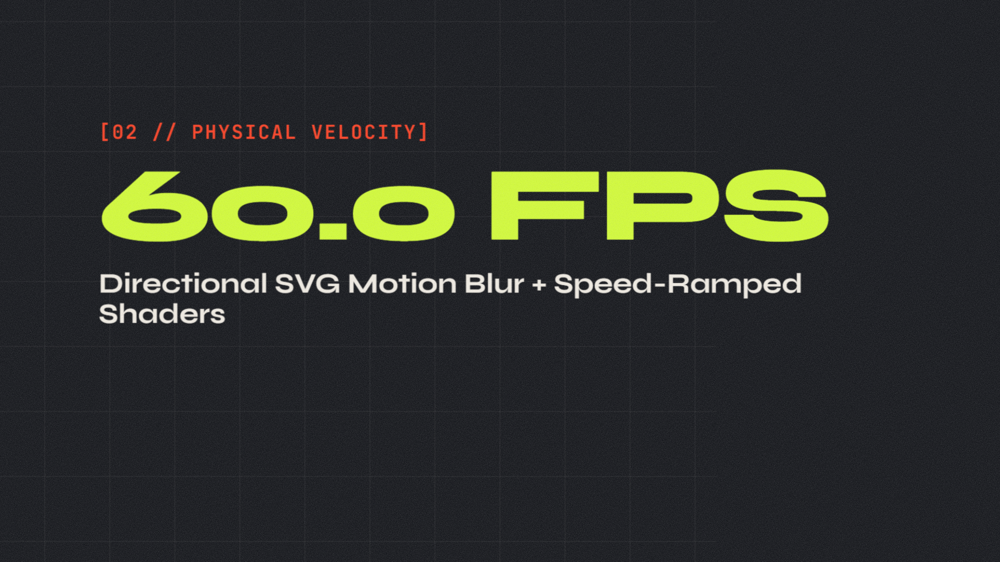 | 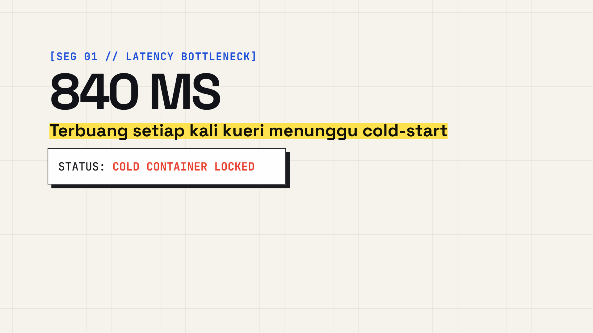 |
| **Speed-ramped `D(t)` 3D particle lattice + directional SVG motion blur** | **VO `SEG`/`PARA` synchronization + `slam` / `block` / `multiply` accretion** |

| 3. Living Cartoon Stage (`starter-explainer-panggung.html`) | 4. Paper Collage & Visual Journalism (`starter-explainer-kolase.html`) |
| :---: | :---: |
|  | 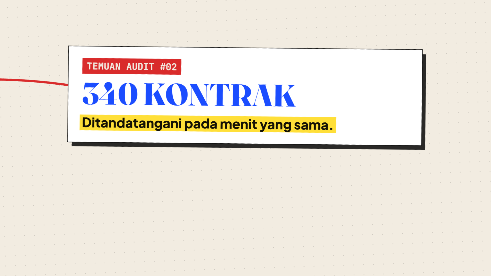 |
| **Articulated SVG Joint Rig `J(el, tx, ty)` + 10+ moving stage props** | **Tactile paper cutout rims + `steps(5)` stop-motion + red yarn evidence map** |

| 5. Clean White Studio Catalog (`starter-explainer-katalog.html`) | 6. Vintage Blueprint & Sketch (`starter-explainer-sketsa.html`) |
| :---: | :---: |
| 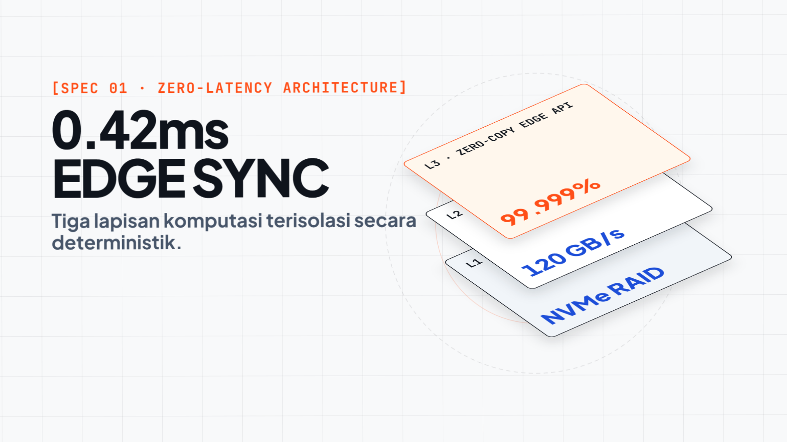 | 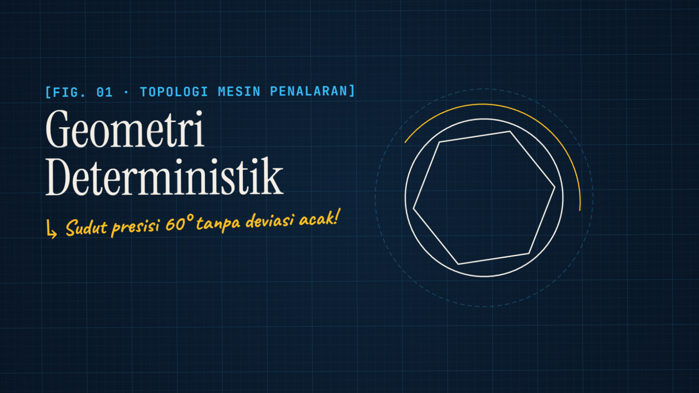 |
| **Pure `#F8F9FA` cyclorama + 3D Isometric Exploded-View layer stack** | **Cyanotype `#0D2238` blueprint grid + live SVG `stroke-dashoffset` schematics** |

---

### 2. The 12 Curated Broadcast Style Directions (`assets/style-gallery.html`)

| `01 · swiss-grid` | `02 · kartun-kolase` | `03 · jurnalisme-visual` |
| :---: | :---: | :---: |
| 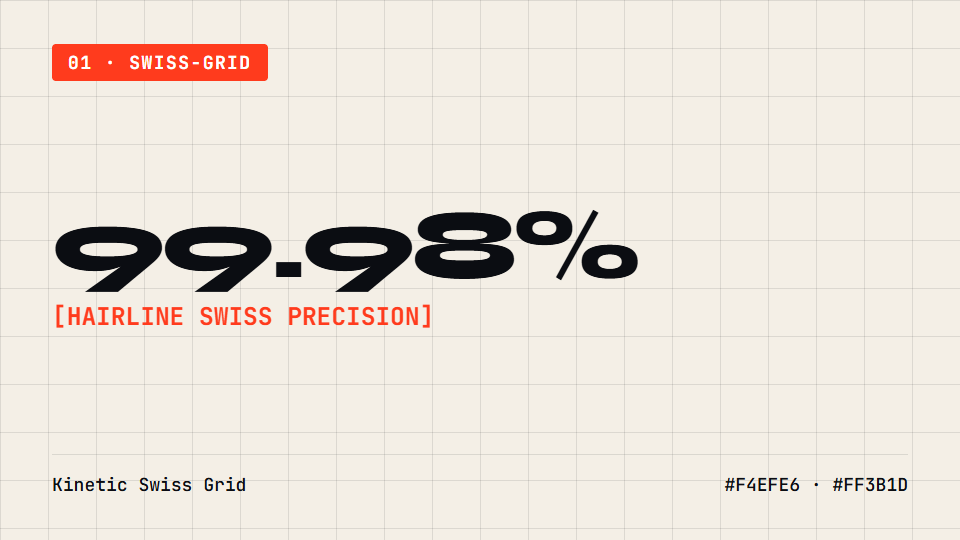 | 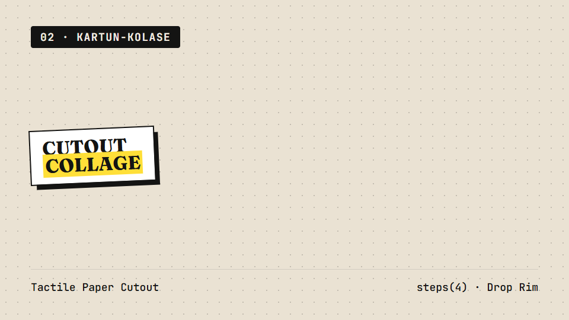 | 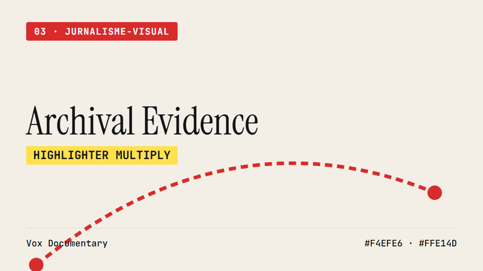 |
| **Stark `1px` hairlines, vermilion & ivory** | **Cutout paper rims & `steps(4)` jitter** | **Vox archival cream & multiply marker** |

| `04 · katalog-putih` | `05 · sketsa-vintage` | `06 · kartun-panggung` |
| :---: | :---: | :---: |
| 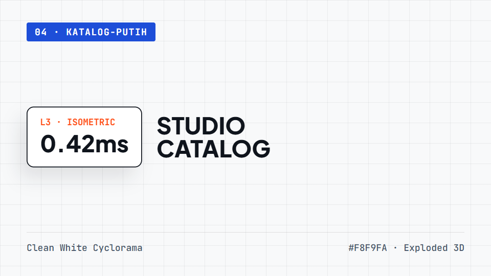 | 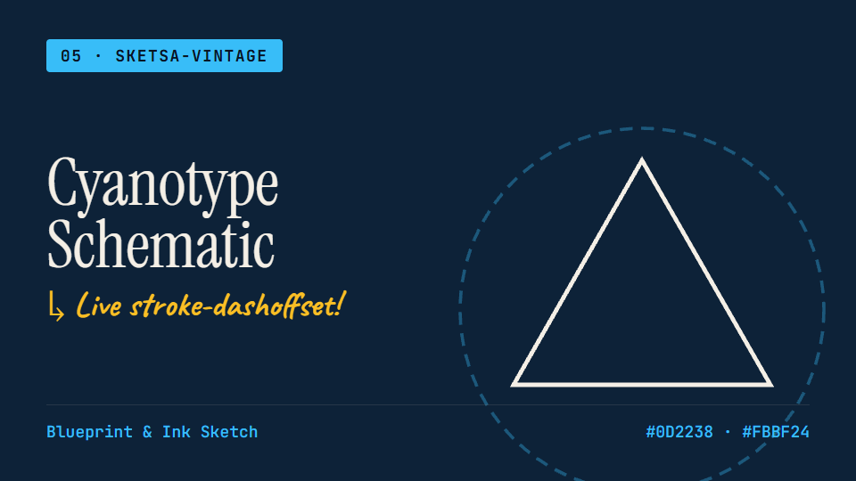 | 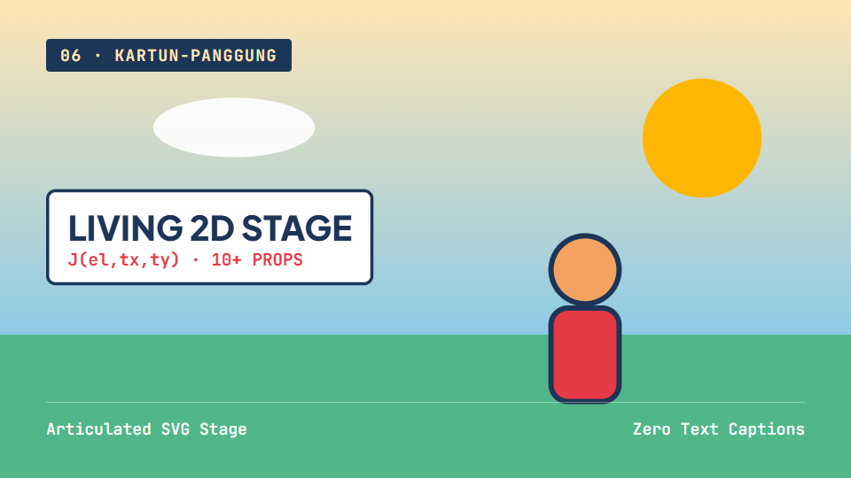 |
| **Studio cyclorama & exploded 3D cards** | **Cyanotype blueprint & live stroke draw** | **2.5D theatrical stage & `J()` joint rigs** |

| `07 · bauhaus-geo` | `08 · brutalist-telemetry` | `09 · editorial-film` |
| :---: | :---: | :---: |
| 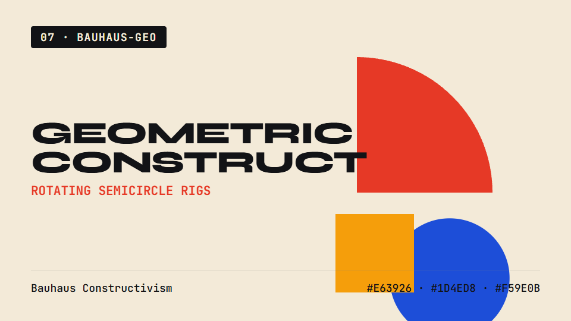 | 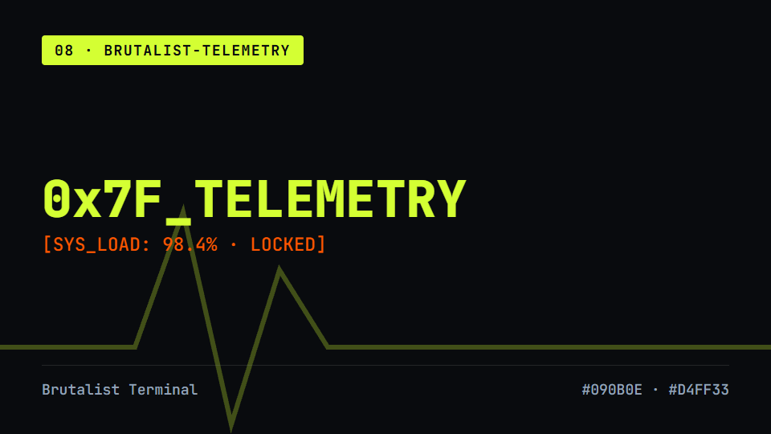 | 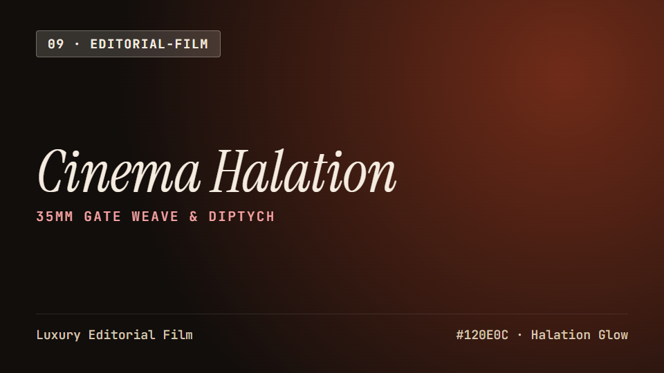 |
| **Primary geometric constructivism** | **Acid lime `#D4FF33` oscilloscope matrix** | **35mm halation glow & italic editorial serif** |

| `10 · isometric-blueprint` | `11 · spatial-optics` | `12 · data-sculpture` |
| :---: | :---: | :---: |
| 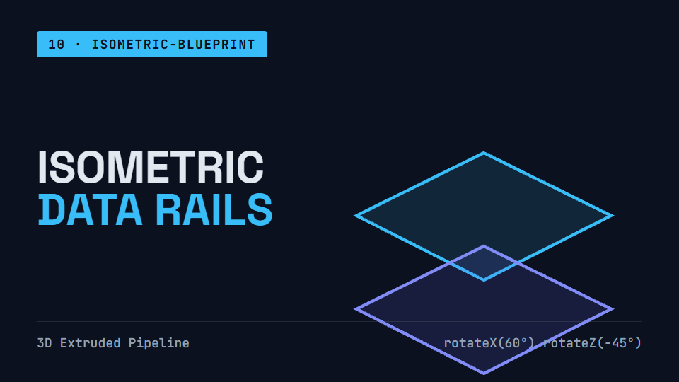 | 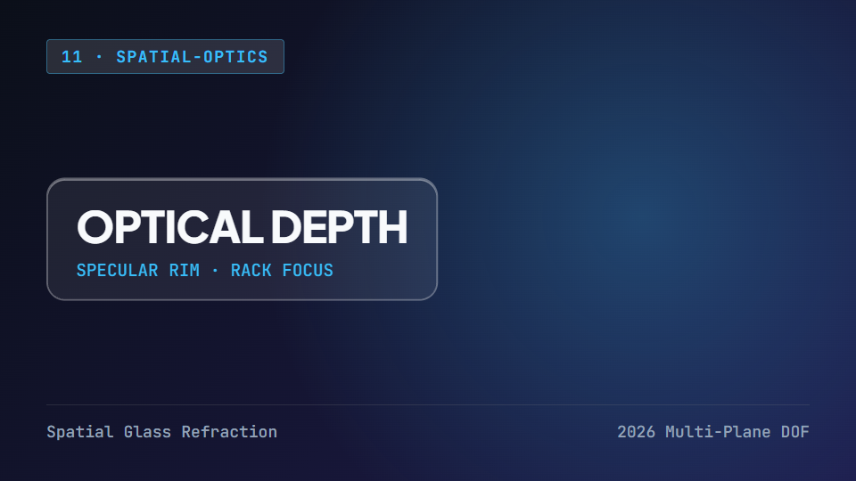 | 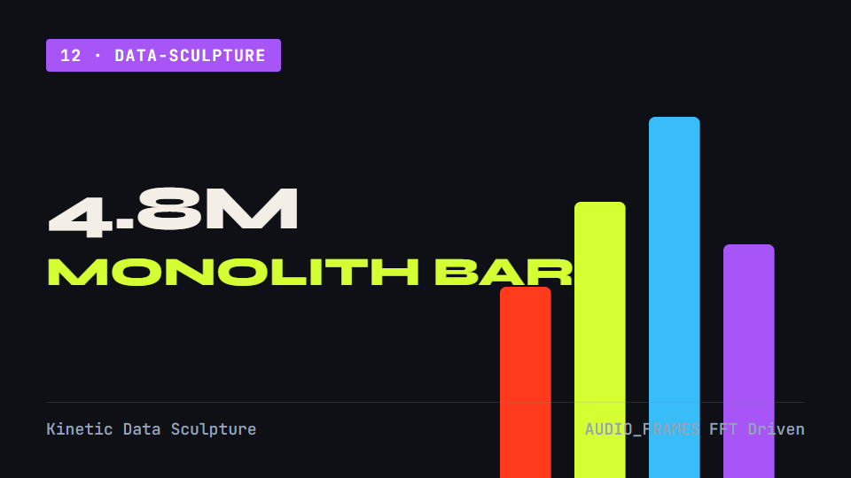 |
| **3D data pipes & payload capsules** | **Chromatic dispersion & rack focus** | **Monolithic 3D data architecture** |

---

## ⚡ Quick Start: One-Command Video Scaffolding

Scaffold a complete broadcast motion project in a single command:

```bash
# 1. Scaffold an Opener with Swiss Grid style, procedural foley and custom duration
npm run scaffold -- my-promo --mode=opener --style=swiss-grid --duration=12 --bpm=128 --mood=cyber --foley

# 2. Inspect keyframes & verify DOM Anti-PPT laws
npm run snap -- my-promo/index.html my-promo/snaps --strict

# 3. Export broadcast 60fps MP4 with GPU acceleration (NVIDIA NVENC / VideoToolbox)
npm run export -- my-promo/index.html my-promo/output.mp4 --fps=60 --gpu=auto --audio=my-promo/audio.wav
```

---

<a name="bahasa-indonesia"></a>
## Bahasa Indonesia

**Cinematic Motion Engine v3.0** adalah suite studio motion graphics broadcast modular yang dirancang oleh **Roedy Rustam** untuk AI coding agents. Dilengkapi dengan **8 Hukum Struktural Anti-PPT**, rig kamera fisik dunia kontinu (`#world`), motion blur berarah SVG, sinkronisasi karaoke Whisper per-kata, desain suara foley prosedural, dan pipeline render 60fps terakselerasi GPU.

### Struktur Modul & Tooling CLI

```text
cinematic-motion-engine/
├── package.json                              # Metadata v3.0.0 (Author: Roedy Rustam)
├── plugin.json                               # Definisi Plugin Antigravity
├── SKILL.md                                  # Master Orchestrator Skill
├── skills/
│   ├── cinematic-motion-engine/SKILL.md      # Mirror Master Skill
│   ├── cme-kinetic-typography/SKILL.md       # Sub-Skill: Tipografi Kinetik & Whisper Sync
│   ├── cme-camera-rigs-3d/SKILL.md           # Sub-Skill: Kamera #world & Shader WebGPU
│   ├── cme-cartoon-puppet-rig/SKILL.md       # Sub-Skill: Rigging Kartun 2D & Lip-Sync
│   ├── cme-audio-reactive-foley/SKILL.md     # Sub-Skill: Desain Suara & Foley Prosedural
│   └── cme-broadcast-renderer/SKILL.md       # Sub-Skill: Render 60fps GPU & QA Gate
├── assets/
│   ├── cme-core.js                           # Universal Deterministic Runtime v3.0
│   ├── starter-opener.html                   # Starter 1: Opener Peluncuran & Shader 3D
│   ├── starter-explainer.html                # Starter 2: Aksi Kontinu & Akresi Frasa
│   ├── starter-explainer-panggung.html       # Starter 3: Panggung Kartun Hidup & Rig J()
│   ├── starter-explainer-kolase.html         # Starter 4: Kolase Kertas & Jurnalisme Visual
│   ├── starter-explainer-katalog.html        # Starter 5: Katalog Studio Putih Isometrik 3D
│   ├── starter-explainer-sketsa.html         # Starter 6: Cetak Biru Sketsa Vintage & Stroke
│   └── style-gallery.html                    # Galeri Interaktif 12 Gaya Visual
└── scripts/
    ├── scaffold-video.mjs                    # Perancah Proyek Video 1-Perintah (Multi-Ratio)
    ├── generate-foley.mjs                    # Generator Desain Suara Foley Prosedural (NEW)
    ├── sync-whisper.mjs                      # Kompilator Karaoke Whisper Per-Kata & Viseme (NEW)
    ├── export-video.mjs                      # Perender 60fps Terakselerasi GPU NVENC/VideoToolbox
    ├── generate-audio.mjs                    # Generator Soundtrack WAV Stereo & AUDIO_FRAMES
    ├── analyze-audio.mjs                     # Penganalisis Jeda Voiceover (SEG/PARA) & FFT 60fps
    ├── audit-anti-ppt.mjs                    # Linter Statis 8 Hukum Anti-PPT
    ├── snap-contact-sheet.mjs                # Pemotret 12 Keyframe + Contact Sheet + Telemetri
    ├── kepala-ekspresi.py                    # Generator 8 Sprite Ekspresi Kepala + Viseme
    └── sync-plugin.mjs                       # Sinkronisator SHA-256 Parity
```

---

<a name="panduan-prompting-ai--contoh-resep-siap-pakai"></a>
## 💬 Panduan Prompting AI & Contoh Resep Siap Pakai

Gunakan **Formula Prompt Broadcast** berikut untuk mengarahkan AI assistant menghasilkan video dengan standar broadcast profesional:

> **📐 Formula Prompt Broadcast:**
> `[Mode Starter (1–6)]` + `[Gaya Visual (01–12)]` + `[Rasio Aspek (16:9|9:16|1:1|4:5)]` + `[Alur Narasi & Objek Visual]` + `[Audio / Whisper / Foley]`

### Contoh Prompt Siap Pakai:

#### 1. Video Reels/TikTok Vertikal 9:16 dengan Subtitle Karaoke Whisper
```text
Gunakan cinematic-motion-engine untuk membuat video Reels vertikal 9:16 berdurasi 12 detik tentang "3 Prinsip Zero-Trust Security untuk Developer".
- Mode=explainer, style=brutalist-telemetry, ratio=9x16.
- Gunakan cme-kinetic-typography dengan syncWhisperTimeline agar setiap kata yang diucapkan menyala kuning acid #D4FF33 dengan efek pop scale 1.15x.
- Pasang efek foley whoosh pada transisi kamera dan impact sub-bass saat poin kunci muncul.
- Verifikasi dengan snap-contact-sheet.mjs dan ekspor ke MP4 60fps.
```

#### 2. Opener Peluncuran Produk SaaS 16:9 4K / 1080p
```text
Buat video opener peluncuran produk "ANTIGRAVITY CODE ENGINE 3.0" berdurasi 10 detik 60fps menggunakan cinematic-motion-engine (mode=opener, style=swiss-grid, mood=cyber, 126 BPM).
- Beat 1: Kamera whip-pan cepat dengan motion blur arah #mb-world menuju klaim hero "KODING OTONOM DETERMINISTIK" (>=110px).
- Beat 2: Kamera menggeser di dalam #world ke matriks telemetri "99.99% PASS RATE".
- Beat 3: Akresi frasa cme-core.js menyusun kartu arsitektur multi-agen.
- Render dengan akselerasi GPU (gpu=auto) ke output.mp4.
```

---

## 📜 License
MIT © Roedy Rustam
