# 🎬 Cinematic Motion Engine

> **Standalone Broadcast Programmatic Motion Graphics, Kinetic Typography, Living Cartoon Stage & 60fps Video Engine for AI Agents**
> *(Antigravity · Claude Code · Cursor · OpenAI Codex · Gemini CLI)*

[](https://github.com/roedyrustam/cinematic-motion-engine/releases/tag/v2.1.0)
[](https://github.com/roedyrustam/cinematic-motion-engine)
[](https://github.com/roedyrustam/cinematic-motion-engine)

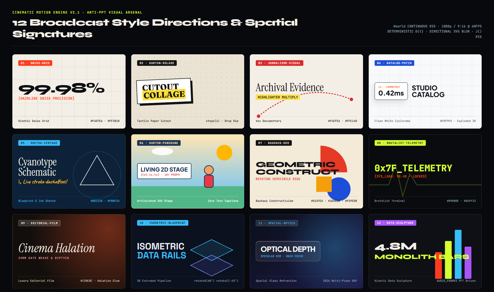

[English](#english) | [Style Gallery](#-visual-style-gallery--6-official-starters) | [Bahasa Indonesia](#bahasa-indonesia)

---

<a name="english"></a>
## English

**Cinematic Motion Engine** is a standalone AI skill and plugin that transforms AI coding assistants into a **broadcast motion graphics studio**. Instead of generating slide-deck fade animations, it enforces **8 Mechanical Anti-PPT Structural Laws**, a continuous `#world` spatial camera rig (`into -> settle -> look -> home`), directional SVG `<feGaussianBlur>` motion blur, deterministic `D(t)` speed-ramped 3D shaders, articulated SVG character joint rigs (`J(el, tx, ty)`), automated Anti-PPT DOM telemetry & contact-sheet verification, and multi-worker / zero-disk pipe **60fps visually lossless MP4 / ProRes 4444 / WebM Alpha export**.

---

## 🎨 Visual Style Gallery & 6 Official Starters

### 1. The 6 Official Production Starters (`assets/starter-*.html`)

| 1. Launch Opener & 3D Shader Rig (`starter-opener.html`) | 2. Aksi Kontinu & Phrase Accretion (`starter-explainer.html`) |
| :---: | :---: |
| 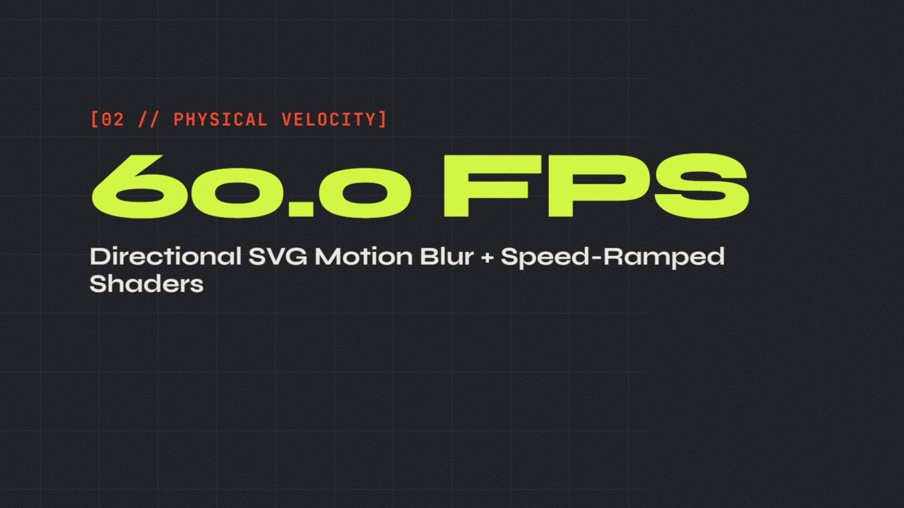 | 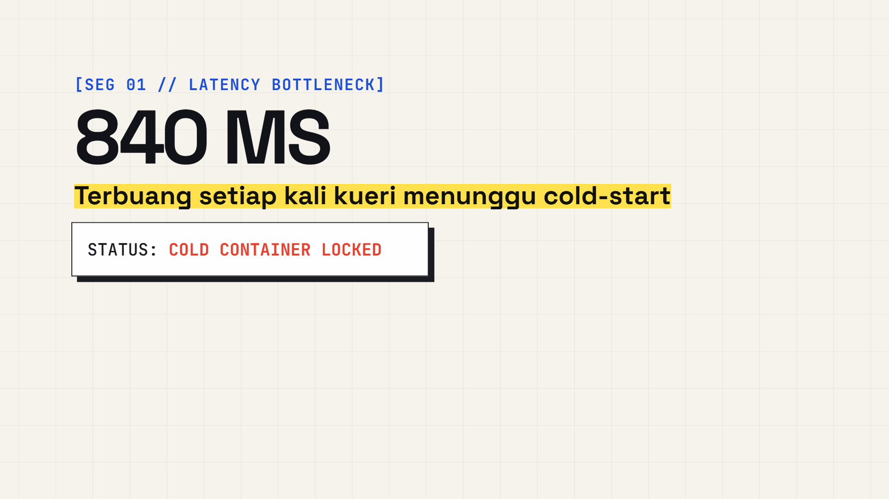 |
| **Speed-ramped `D(t)` 3D particle lattice + directional SVG motion blur** | **VO `SEG`/`PARA` synchronization + `slam` / `block` / `multiply` accretion** |

| 3. Living Cartoon Stage (`starter-explainer-panggung.html`) | 4. Paper Collage & Visual Journalism (`starter-explainer-kolase.html`) |
| :---: | :---: |
|  | 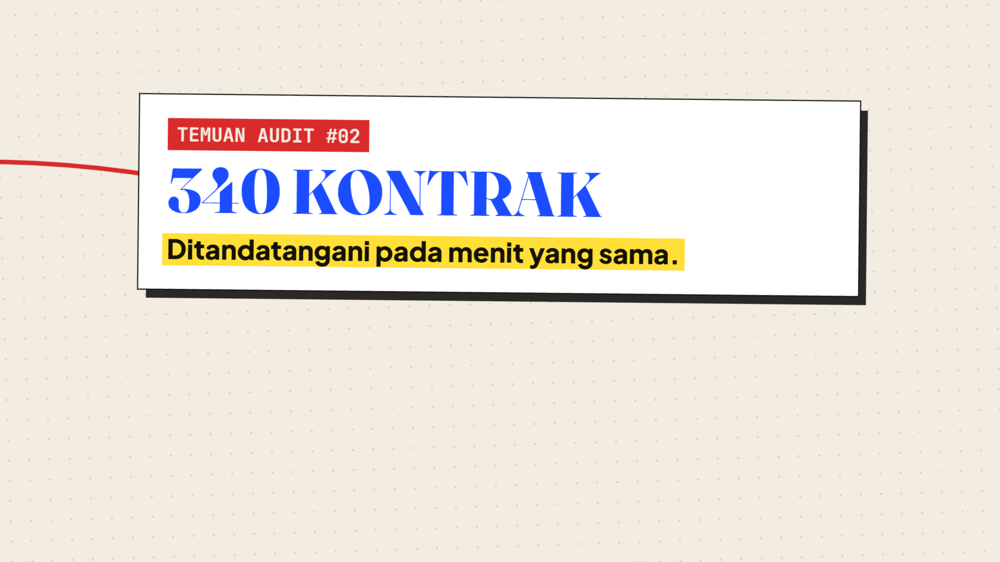 |
| **Articulated SVG Joint Rig `J(el, tx, ty)` + 10+ moving stage props** | **Tactile paper cutout rims + `steps(5)` stop-motion + red yarn evidence map** |

| 5. Clean White Studio Catalog (`starter-explainer-katalog.html`) | 6. Vintage Blueprint & Sketch (`starter-explainer-sketsa.html`) |
| :---: | :---: |
| 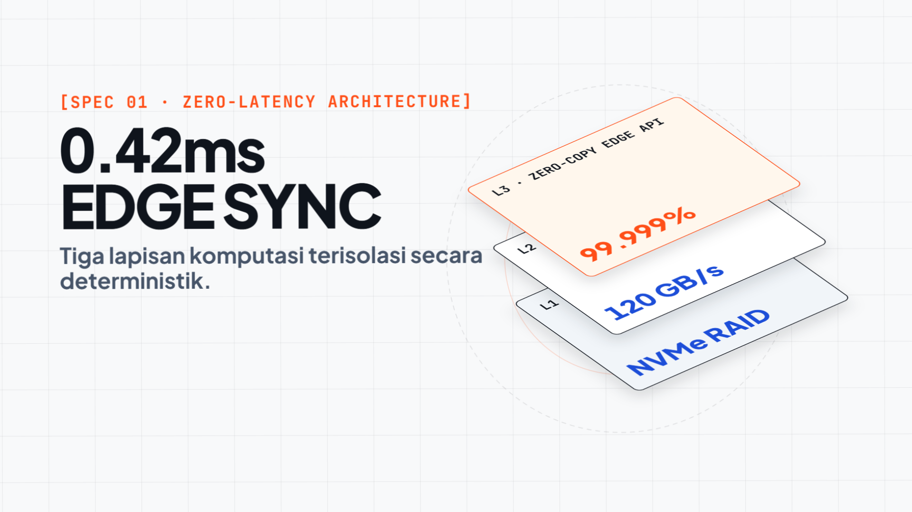 | 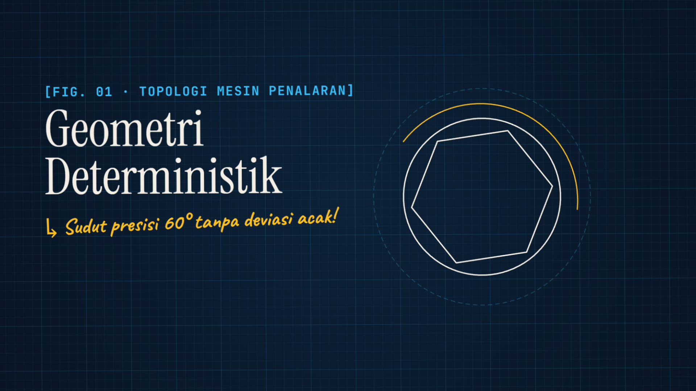 |
| **Pure `#F8F9FA` cyclorama + 3D Isometric Exploded-View layer stack** | **Cyanotype `#0D2238` blueprint grid + live SVG `stroke-dashoffset` schematics** |

---

### 2. The 12 Curated Broadcast Style Directions (`assets/style-gallery.html`)

| `01 · swiss-grid` | `02 · kartun-kolase` | `03 · jurnalisme-visual` |
| :---: | :---: | :---: |
| 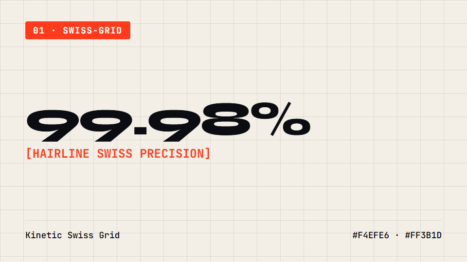 | 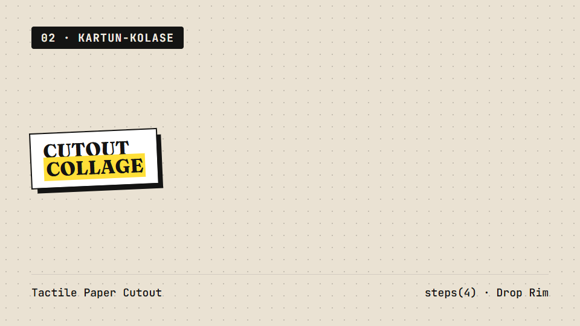 | 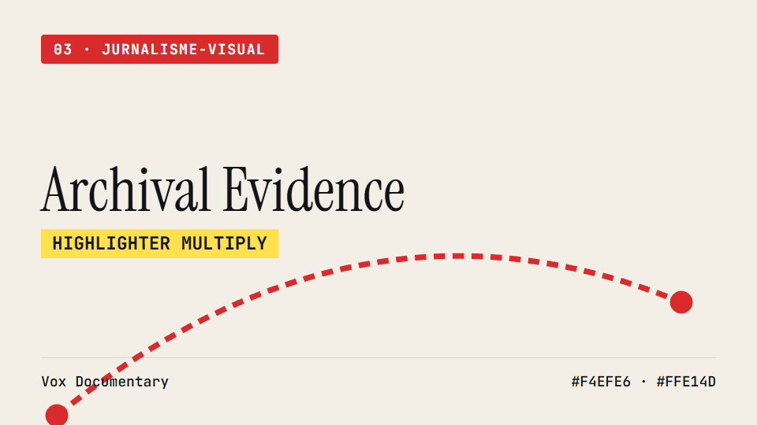 |
| **Stark `1px` hairlines, vermilion & ivory** | **Cutout paper rims & `steps(4)` jitter** | **Vox archival cream & multiply marker** |

| `04 · katalog-putih` | `05 · sketsa-vintage` | `06 · kartun-panggung` |
| :---: | :---: | :---: |
| 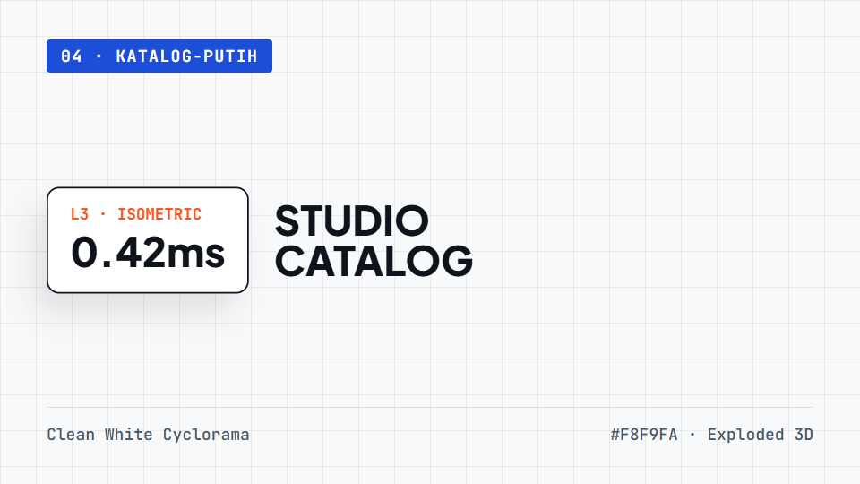 | 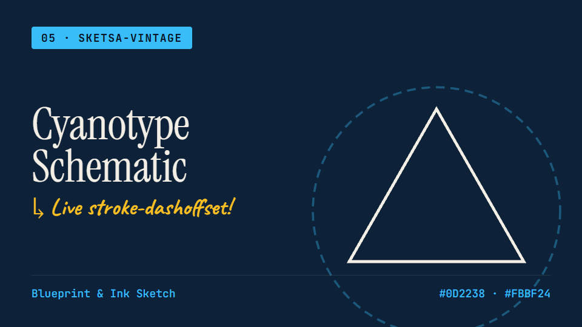 | 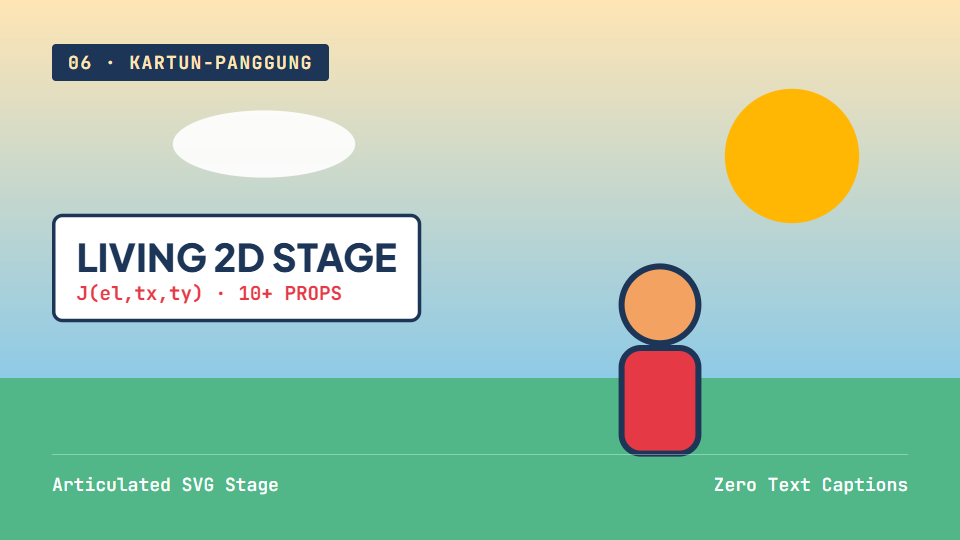 |
| **Studio cyclorama & exploded 3D cards** | **Cyanotype blueprint & live stroke draw** | **2.5D theatrical stage & `J()` joint rigs** |

| `07 · bauhaus-geo` | `08 · brutalist-telemetry` | `09 · editorial-film` |
| :---: | :---: | :---: |
| 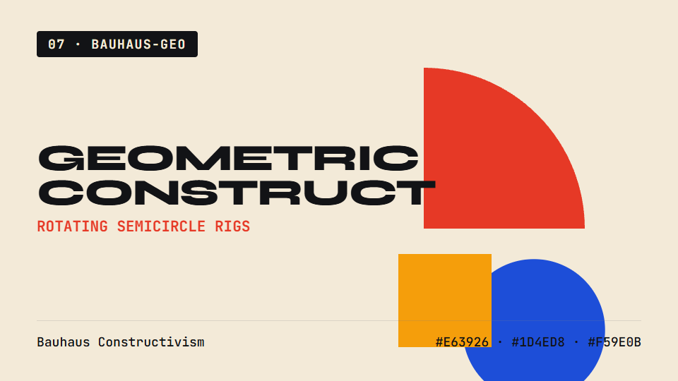 | 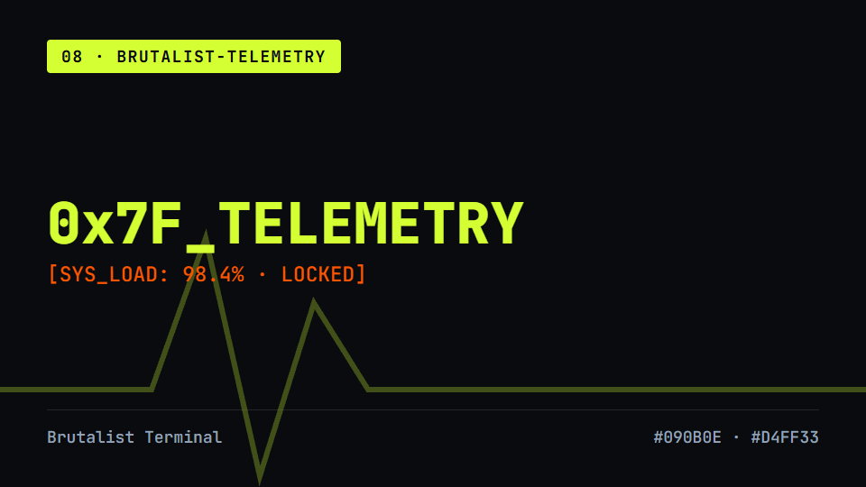 | 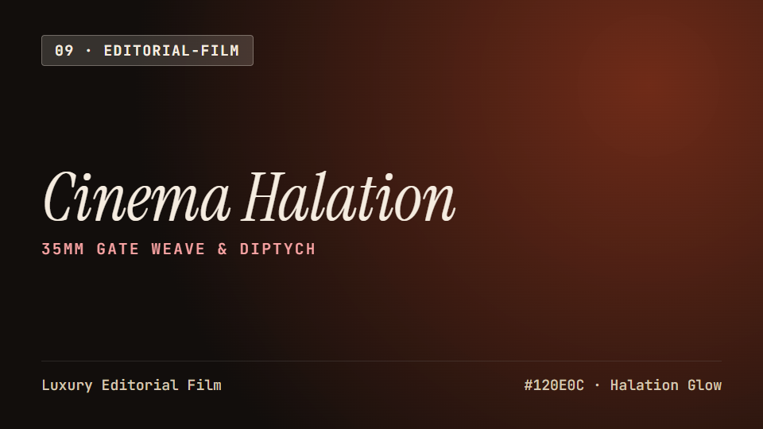 |
| **Primary geometric constructivism** | **Acid lime `#D4FF33` oscilloscope matrix** | **35mm halation glow & italic editorial serif** |

| `10 · isometric-blueprint` | `11 · spatial-optics` | `12 · data-sculpture` |
| :---: | :---: | :---: |
| 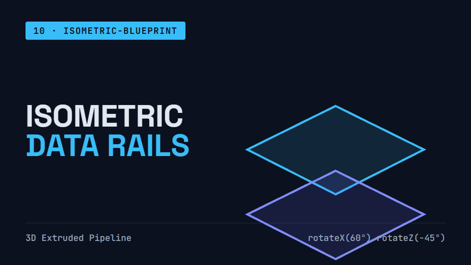 | 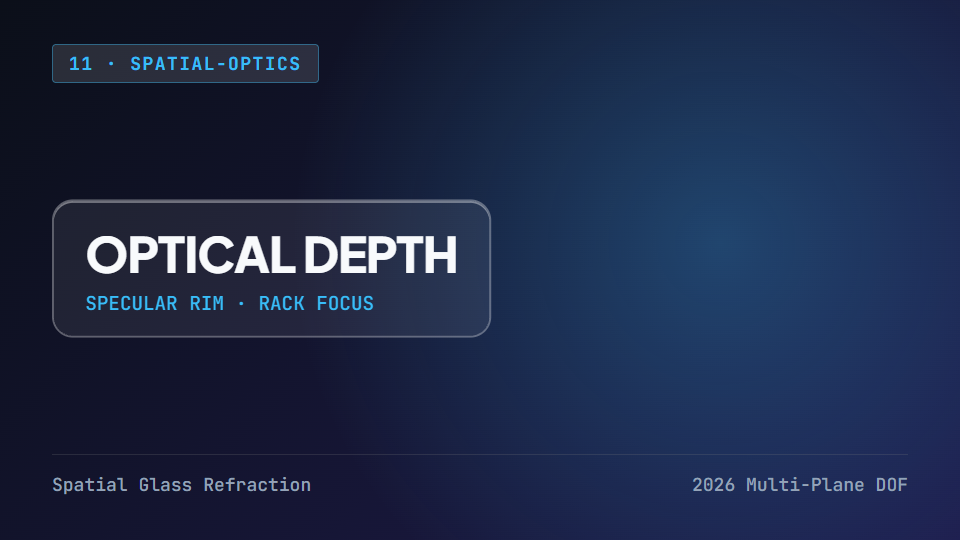 | 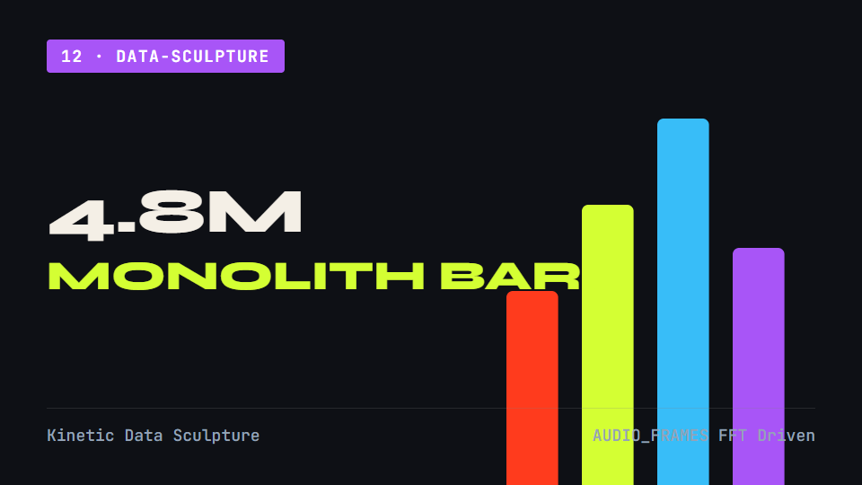 |
| **True `30°/60°` extruded data pipelines** | **Specular glass rim & rack-focus depth** | **`AUDIO_FRAMES` FFT monolith bar architecture** |

> 💡 **Regenerate Gallery Anytime**: Run `npm run gallery` (`node scripts/generate-gallery.mjs`) to deterministically render all 19 PNG previews from `assets/style-gallery.html` and `assets/starter-*.html`.

---

### ✨ Key Features (v2.1 Upgrade)
- **Zero Slide Decks (`#world` Continuous Spatial Rig)**: Unified `4720×3880` world canvas wrapping WebGL/Three.js (`<canvas id="gl">`), SVG isometric pipelines, and DOM typography in 1:1 spatial parallax.
- **100% Frame-Deterministic**: Pure mathematical functions of `tl.time()`, `mulberry32` PRNG, and precomputed velocity integral `D(t)`. Zero `Math.random()` or `Date.now()` drift.
- **Directional SVG Motion Blur**: Dynamic `<feGaussianBlur>` (`#mb-world`) attached during high-velocity whip-pans and detached immediately upon settling for razor-sharp typography.
- **Autonomous CLI Audio, Anti-PPT Telemetry & 60fps Renderer**:
  - `npm run audio` (`scripts/generate-audio.mjs`): CLI procedural stereo WAV & 60fps `AUDIO_FRAMES` synthesizer (`--mood=warm|cyber|editorial|corporate`, `--bpm`, `--duration`, `--drops`).
  - `npm run analyze` (`scripts/analyze-audio.mjs`): Headless CLI voiceover silence (`SEG`/`PARA`) & 60fps FFT compiler for `.wav/.mp3/.m4a`.
  - `npm run snap` (`scripts/snap-contact-sheet.mjs`): Captures 12 beat keyframes, runs in-browser Anti-PPT DOM telemetry checks (`audit-report.json`), and stitches a labeled `contact-sheet.png`.
  - `npm run audit` (`scripts/audit-anti-ppt.mjs`): Fast static & structural Anti-PPT 8-Law linter.
  - `npm run export` (`scripts/export-video.mjs`): Spawns dedicated browser workers or streams via `--pipe` (`image2pipe`) into FFmpeg (`--codec=h264|prores|webm-alpha`, `--ratio=16x9|9x16|1x1`).
  - `npm run gallery` (`scripts/generate-gallery.mjs`): Automated 19-image visual style gallery & starter keyframe generator.
  - `scripts/kepala-ekspresi.py`: Alpha-bounding-box aware 8-expression character head sprite generator + parametric `viseme-rig.svg`.
  - `npm run sync` (`scripts/sync-plugin.mjs`): Deterministic SHA-256 synchronizer between root and `skills/cinematic-motion-engine/`.

### 🚀 Installation

#### 1. Antigravity (AGY) — Standalone Skill or Plugin
```bash
# As a Global Standalone Skill:
git clone https://github.com/roedyrustam/cinematic-motion-engine.git ~/.gemini/config/skills/cinematic-motion-engine

# Or as a Standalone Plugin:
git clone https://github.com/roedyrustam/cinematic-motion-engine.git ~/.gemini/config/plugins/cinematic-motion-engine
```

#### 2. Claude Code / Cursor / Workspace Skill
```bash
git clone https://github.com/roedyrustam/cinematic-motion-engine.git .agents/skills/cinematic-motion-engine
```

---

<a name="bahasa-indonesia"></a>
## Bahasa Indonesia

**Cinematic Motion Engine (v2.1)** adalah skill dan plugin AI mandiri (*standalone*) yang mengubah asisten coding AI menjadi **studio motion graphics kelas broadcast**. Menggantikan animasi ala slide PowerPoint dengan **8 Hukum Struktural Mekanis Anti-PPT**, rig kamera dunia kontinu `#world`, *motion blur* arah SVG `<feGaussianBlur>`, shader 3D *speed-ramp* deterministik `D(t)`, rig sendi karakter kartun SVG `J(el, tx, ty)`, galeri visual 12 gaya broadcast (`npm run gallery`), audit telemetri DOM & *contact-sheet* otomatis (`npm run snap`), serta perender paralel **MP4 / ProRes 4444 / WebM Alpha 60fps** (`npm run export`).

### 📁 Struktur Direktori
```text
cinematic-motion-engine/
├── SKILL.md                                  # Instruksi utama skill (EN / ID)
├── PRD.md                                    # Dokumen Kebutuhan Produk v2.1
├── BLUEPRINT.md                              # Cetak Biru Arsitektur & MADR Decision Log
├── plugin.json                               # Manifest plugin mandiri Antigravity
├── docs/
│   └── gallery/                              # 19 Gambar Preview Galeri Gaya & Starter (Otomatis)
├── rules/
│   └── AGENTS.md                             # Aturan aktivasi otomatis Anti-PPT
├── assets/
│   ├── style-gallery.html                    # Katalog Visual 12 Arah Gaya Broadcast
│   ├── starter-opener.html                   # Starter Video Opener / Brand Reel (16:9, 9:16, 1:1)
│   ├── starter-explainer.html                # Starter Explainer Aksi Kontinu
│   ├── starter-explainer-panggung.html       # Starter Kartun Panggung Hidup (SVG Joint Rig)
│   ├── starter-explainer-kolase.html         # Starter Kolase Kertas & Jurnalisme Visual
│   ├── starter-explainer-katalog.html        # Starter Katalog Putih & 3D Isometric Exploded View
│   └── starter-explainer-sketsa.html         # Starter Sketsa Vintage & Cyanotype Blueprint
├── references/
│   ├── anti-ppt-laws.md                      # 8 Hukum Mekanis Anti-PPT & Matematika Skala 1080p
│   ├── opener-concepts.md                    # 24 Konsep Opener & 35+ Transisi Objek
│   ├── explainer-modes.md                    # 6 Mode Explainer & Akresi Frasa
│   ├── techniques-and-shaders.md             # Kamera #world, Blur SVG, & Shader D(t)
│   └── kartun-panggung-and-ae-bridge.md      # Rig Sendi J() & Bridge After Effects MCP
└── scripts/
    ├── generate-gallery.mjs                  # Generator Otomatis 19 Gambar Style Gallery & Starter
    ├── snap-contact-sheet.mjs                # Pemotret 12 Keyframe + Penyusun Contact Sheet + DOM Linter
    ├── audit-anti-ppt.mjs                    # Linter Statis & Struktural 8 Hukum Anti-PPT
    ├── export-video.mjs                      # Perender 60fps (Multi-Worker / Zero-Disk Pipe / Multi-Codec)
    ├── generate-audio.mjs                    # CLI Generator Soundtrack WAV Stereo & AUDIO_FRAMES
    ├── analyze-audio.mjs                     # CLI Penganalisis Jeda Voiceover (SEG/PARA) & FFT 60fps
    ├── vo-fft-analyzer.html                  # Penganalisis Jeda Voiceover & Kurva Audio FFT (Browser GUI)
    ├── kepala-ekspresi.py                    # Generator 8 Sprite Ekspresi Kepala + SVG Viseme Rig
    └── sync-plugin.mjs                       # Sinkronisator SHA-256 Root <-> skills/cinematic-motion-engine
```

---

## 📜 License
MIT © Roedy Rustam
