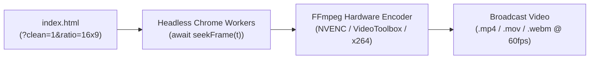

# CME Broadcast Renderer & Visual Quality Gate (v3.0)

[English](#english) | [Bahasa Indonesia](#bahasa-indonesia)

---

<a name="english"></a>
## English

### Overview & Capabilities
`cme-broadcast-renderer` is the high-performance export and automated quality assurance sub-skill of the **Cinematic Motion Engine**. It captures frame-accurate 60fps animations through headless browser instances awaiting `window.OPENER.seekFrame(t)`, encodes visually lossless video using GPU hardware acceleration (NVIDIA NVENC, Apple Silicon VideoToolbox), supports transparent alpha channels (ProRes 4444 / WebM), and executes mechanical Anti-PPT DOM linting.

### 1. The Rendering Pipeline



### 2. Export Commands & Codec Flags

#### A. Fast GPU-Accelerated H.264 Export
```bash
# Auto-detects NVIDIA NVENC or Apple VideoToolbox for 3x-5x faster exports
node scripts/export-video.mjs index.html output.mp4 --fps=60 --gpu=auto --audio=audio.wav
```

#### B. Transparent Alpha Video for NLE Editors (After Effects / Premiere / DaVinci)
```bash
# Apple ProRes 4444 with true alpha channel
node scripts/export-video.mjs index.html overlay.mov --codec=prores --fps=60

# WebM VP9 with transparent alpha
node scripts/export-video.mjs index.html overlay.webm --codec=webm-alpha --fps=60
```

#### C. Multi-Aspect Ratio Export
```bash
# Vertical 9:16 for Reels, TikTok, Shorts (1080x1920)
node scripts/export-video.mjs index.html reel.mp4 --ratio=9x16 --audio=audio.wav

# Square 1:1 for Social Feed (1080x1080)
node scripts/export-video.mjs index.html square.mp4 --ratio=1x1 --audio=audio.wav

# Portrait 4:5 for Carousel Ads (1080x1350)
node scripts/export-video.mjs index.html portrait.mp4 --ratio=4x5 --audio=audio.wav
```

---

### 3. Automated Anti-PPT Telemetry & Contact Sheet QA

Before delivering any video project, run the mechanical verification tools:

1. **Static AST Linter (`scripts/audit-anti-ppt.mjs`)**:
   Verifies zero slide-deck container fades, zero `Math.random()`, minimum font sizes $\ge 30\text{px}$, and presence of `#world` camera rigs.
   ```bash
   node scripts/audit-anti-ppt.mjs index.html --strict
   ```

2. **12-Beat Visual Contact Sheet (`scripts/snap-contact-sheet.mjs`)**:
   Captures 12 beat timestamps, checks safe-zone compliance, detects lingering motion blur filters, and stitches a single labeled contact sheet image (`contact-sheet.png`):
   ```bash
   node scripts/snap-contact-sheet.mjs index.html ./snaps --strict
   ```

---

<a name="bahasa-indonesia"></a>
## Bahasa Indonesia

### Ikhtisar & Kemampuan
`cme-broadcast-renderer` menyediakan pipeline rendering video 60fps presisi frame dengan akselerasi GPU (NVENC/VideoToolbox), ekspor kanal transparansi alpha (ProRes 4444 / WebM VP9), dukungan multi-rasio aspek (16:9, 9:16, 1:1, 4:5), serta gerbang pengujian kualitas DOM Anti-PPT otomatis.

### Aturan Kualitas Wajib:
- Jangan pernah mengirimkan kode ke pengguna tanpa menjalankan `audit-anti-ppt.mjs` dan `snap-contact-sheet.mjs`.
- Pastikan semua beat terpenting bersih dari teks yang terpotong di luar area aman (*safe-zone*).
